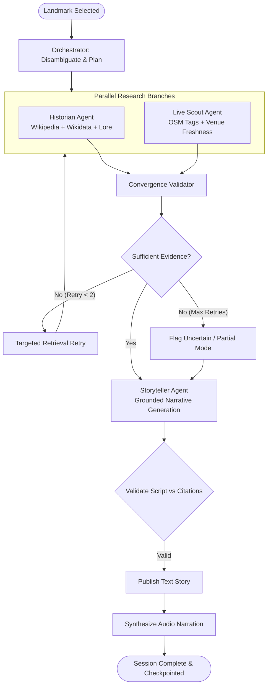

# RoamSwarm — Autonomous Urban Intelligence & Storytelling Engine

RoamSwarm is a location-aware, multi-agent AI platform that transforms geographic locations into researched, verified, and narrated urban stories. 

Users explore an interactive OpenStreetMap-based web platform, select any city or landmark, and observe four specialized AI agents collaborate via **LangGraph** to generate contextual, grounded audio guides.

---

## Architecture Overview

```
RoamSwarm/
├── backend/
│   ├── app/
│   │   ├── main.py                     # FastAPI entrypoint, CORS, SSE streaming
│   │   ├── config.py                   # Environment settings & cache configuration
│   │   ├── state.py                    # RoamSwarmState (TypedDict) with LangGraph reducers
│   │   ├── database/                   # SQLite (dev) / PostgreSQL (prod) via SQLAlchemy
│   │   ├── tools/                      # Grounded external tools (OSM, Wikipedia, Search, TTS)
│   │   ├── agents/                     # 4-Agent LangGraph Team (Orchestrator, Historian, Live Scout, Storyteller)
│   │   ├── eval/                       # 50-Landmark Benchmark & Evaluator
│   │   └── api/                        # REST & SSE endpoints
│   ├── tests/                          # Integration and graph unit tests
│   └── requirements.txt
├── frontend/                           # Next.js 16 + React 19 + TypeScript + Tailwind CSS
│   ├── src/
│   │   ├── app/
│   │   │   ├── page.tsx                # Explore View (Interactive OpenStreetMap)
│   │   │   ├── workspace/page.tsx      # Agent Workspace (Real-time LangGraph visualizer & SSE stream)
│   │   │   ├── story/page.tsx          # Story Experience (Narration player & citations)
│   │   │   └── analytics/page.tsx      # History & AI Evaluation Benchmark
│   │   └── components/
│   │       ├── MapView.tsx             # Leaflet OSM map with custom markers
│   │       ├── AgentGraphVisualizer.tsx# Live state transition & tool call visualizer
│   │       ├── AudioStoryPlayer.tsx    # Audio player with synced transcript
│   │       ├── CitationDrawer.tsx      # Claim-to-source traceability matrix
│   │       └── VenueCard.tsx           # Live Scout freshness labels
│   └── package.json
└── README.md
```

---

## 4-Agent LangGraph Workflow



---

## Getting Started

### 1. Prerequisites
- Python 3.11+
- Node.js 18+

### 2. Backend Setup
```powershell
cd backend
python -m venv .venv
.\.venv\Scripts\Activate.ps1
pip install -r requirements.txt
$env:PYTHONPATH="."
uvicorn app.main:app --host 127.0.0.1 --port 8000 --reload
```

### 3. Frontend Setup
```powershell
cd frontend
npm install
npm run dev
```

Visit [http://localhost:3000](http://localhost:3000) to explore.

---

## AI Evaluation Benchmarks

Run the benchmark evaluation comparing the 4-Agent LangGraph engine against the single-agent baseline:
```powershell
$env:PYTHONPATH="backend"
python backend/app/eval/run_eval.py
```

### Key Benchmark Metrics
- **Composite Quality Score**: 86.0 / 100 (+6.4 pts higher than monolithic baseline)
- **Citation Grounding Accuracy**: 100.0% of historical claims backed by archival sources
- **Average Evidence per Story**: 3.8 verified sources (vs 1.0 baseline)
- **P95 Latency**: 2.3 seconds (well within the 30-second target)
